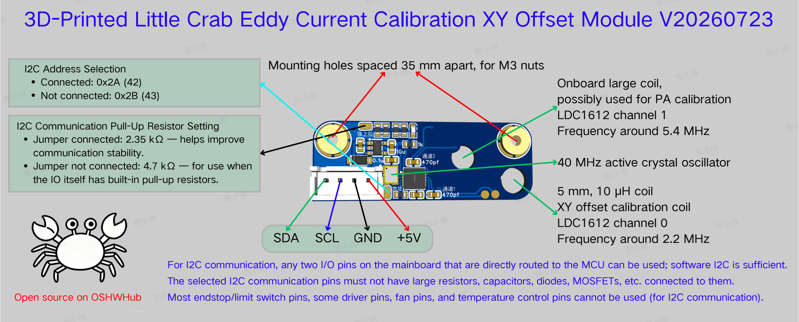

# tool_eddy_calibration

English | [中文](README.md)

XY nozzle offset calibration plugin for multi-toolchanger Klipper printers. Using a
bed-mounted LDC1612/LDC1614 eddy current sensor board, the nozzle scans along
multiple straight-line directions; peak response positions are located and the
tool center coordinates are reconstructed geometrically (paired averaging /
least squares), yielding XY offsets between tools.



- Non-contact measurement — works with a dirty nozzle
- Uses Klipper's official `ldc1612.py` driver by default (channel 0 only).
  Set `use_custom_ldc1612_driver: True` to use the bundled `ldc1612_2.py`
  driver with runtime-switchable channels 0-3; each channel has its own coil
  position and scan settings
- `TOOL_EDDY_FIND_COIL` automatic serpentine raster search for the coil center —
  no manual coordinate measuring; the macro suite persists the result as the
  shared `coil_x/y_{channel}`, found once and common to all tools
- Signal shape auto-detection (peak / valley); peak search is anchored to the
  middle band of each scan, suppressing stray side responses
- Gaussian-weighted parabolic fitting for sub-sample peak localization
- Sensor timestamps are mapped to XY using Klipper's planned acceleration/cruise/deceleration profile; samples outside the move are no longer extrapolated along the scan line
- Optional paired forward/reverse scans to cancel motion hysteresis
- Results carry a trust verdict (`trusted` / `fitR2` / `deviation` /
  `edgeScans`): fit R² must satisfy `trust_min_r2 <= R² < 1.0`, the
  result must not deviate from the initial scan center, and the peak must not
  sit at the edge of a scan line — any violation marks the result untrusted
- Scan lines and search regions are automatically clamped to the kinematic
  axis range (whole-line shift, never truncated) — an edge-hugging coarse
  center no longer causes out-of-range errors
- Z offset is supplied externally (e.g. `probe_eddy_current` with
  `METHOD=TAP`) and written via `SET_TOOL_Z`

Hardware reference: [oshwhub "Little Crab" dual-coil board](https://oshwhub.com/cxg01/project_lbabffjk)
(schematics / Gerber in the [hardware/](hardware/) directory)

Version: **V2.2.1** (query with the `TOOL_EDDY_VERSION` command)

## Repository layout

```
tool_eddy_calibration/
├── klipper/                    # The plugin itself
│   ├── tool_eddy_calibration.py    # Host-side plugin (goes to klippy/extras/)
│   ├── ldc1612_2.py                # Multi-channel LDC1612/1614 driver (klippy/extras/)
│   ├── firmware/sensor_ldc1612_2.c # MCU-side sampling module (src/, needs firmware rebuild)
│   ├── install.sh                  # Install script
│   └── uninstall.sh                # Uninstall script
├── config/                     # Reference configurations
│   ├── calibration-eddy.cfg    # Full calibration macro suite (ready to include)
│   ├── printer.cfg             # [tool_eddy_calibration] config example
│   ├── printer_probe_eddy.cfg  # probe_eddy_current (tap) config example
│   ├── myvariables.cfg         # save_variables example
│   └── moonraker.conf          # Moonraker update-manager config
├── hardware/                   # Hardware files (schematic PDF / Gerber)
├── img/                        # Documentation images
├── data/                       # Data files (sample scan CSVs, peak-fitting visualization demo)
└── LICENSE                     # GPLv3
```

## Installation

### Option 1: manual install

```bash
cd ~
git clone https://github.com/chengxg/tool_eddy_calibration.git
# Users in China: git clone https://gitee.com/chengxiaogang/tool_eddy_calibration.git
cd tool_eddy_calibration
bash ./klipper/install.sh
```

Installs to `~/klipper` by default; pass the directory if klipper lives
elsewhere:

```bash
bash ./klipper/install.sh /path/to/klipper
```

The script links host-side modules into `klippy/extras/` (falls back to
copying when symlinks are unavailable) and places the firmware module
`sensor_ldc1612_2.c` into `src/`, idempotently patching `src/Makefile`
(`--host-only` skips the firmware part). Previously hand-copied files are
backed up as `*.bak`.

### Option 2: Moonraker-managed install (recommended)

Install manually first (option 1), then append the contents of
[config/moonraker.conf](config/moonraker.conf) to your printer's
`moonraker.conf` and restart moonraker:

```ini
[update_manager tool_eddy_calibration]
type: git_repo
# origin: https://gitee.com/chengxiaogang/tool_eddy_calibration.git  # for users in China
origin: https://github.com/chengxg/tool_eddy_calibration.git
path: ~/tool_eddy_calibration
install_script: klipper/install.sh
managed_services: klipper
primary_branch: master
```

The plugin then shows up on the Mainsail / Fluidd update page — check for
updates and upgrade with one click; Moonraker runs the install script and
restarts klipper afterwards.

> Note: `primary_branch` must match the repo's default branch name
> (`master` for this repo).

## Firmware requirements (multi-channel)

Single-channel calibration (`CHANNEL=0`) needs no firmware changes and works
on any Klipper / Kalico. **Multi-channel coil switching** (`CHANNEL=1..3`)
requires the MCU-side sampling module `sensor_ldc1612_2.c` (multi-channel
variant with `_2`-suffixed symbols, coexisting with the stock
`sensor_ldc1612.c`):

| Firmware file | Source |
|---|---|
| `src/sensor_ldc1612.c`, `src/sensor_bulk.c`, `src/trigger_analog.c/.h`, `src/sos_filter.c/.h` | Stock (requires a recent Klipper / Kalico) |
| `src/sensor_ldc1612_2.c` | Bundled in this repo, `klipper/firmware/` |

`install.sh` copies `sensor_ldc1612_2.c` into `src/` and idempotently patches
`src/Makefile` with the build entry. If the stock modules above are missing
(too old), the installer aborts — this plugin does not support old firmware;
upgrade Klipper / Kalico first. To install host-side only, run
`bash ./klipper/install.sh --host-only`.

After installing, **rebuild and flash the firmware**:

```bash
cd ~/klipper
make menuconfig    # make sure I2C is enabled (LDC1612 support is on by default), save & exit
make
make flash         # or however you flash your board
```

After flashing and restarting, run `TEST_LDC1612` to verify the sensor and
`TOOL_EDDY_VERSION` to confirm the plugin version and driver (by default it
should show `version: 2.2.1`, `driver: ldc1612`).

> Note: after a Moonraker update, if the firmware sources changed you must
> rebuild and re-flash manually (Moonraker restarts klipper but never flashes
> firmware).

## Configuration

Add to `printer.cfg` (the section suffix is yours to choose; one section per
sensor board):

```ini
[tool_eddy_calibration my_coil]
sensor_type: ldc1612
# Sensor I2C and driver options (same as [ldc1612 ...], inside this section)
#i2c_mcu: rpi
#i2c_bus: i2c1
#i2c_address: 42          # default 0x2a
#frequency: 12000000      # external CLKIN frequency, set to your hardware
#data_rate: 400           # sample rate (Hz), ~5000 max (settling-time limited),
                          # minimum depends on frequency (≈39 at 40MHz)
#reg_drive_current: 25
# Uses the official ldc1612.py driver by default; only CHANNEL=0 is allowed.
# Set True to use bundled ldc1612_2.py and enable CHANNEL=1..3.
#use_custom_ldc1612_driver: False

# Coil plane Z (machine coordinates)
coil_z: 0.5
# Default coil search region; TOOL_EDDY_FIND_COIL REGION= overrides per-call
find_coil_region: 90,90,110,110
# Coil inner diameter (mm), sizes the peak fitting window
#coil_inner_diameter: 2.0

# Scan parameters (relative to the coil surface; negative scan_height = below it)
#scan_height: 0.5
#scan_speed: 5.0
#scan_length: 10.0

# Per-channel overrides for channels 1-3 (default: channel 0 values;
# requires use_custom_ldc1612_driver: True, ldc1612_2.py, and multi-coil hardware)
#coil_z1: 0.5
#find_coil_region1: 95,90,115,110
#coil_inner_diameter1: 2.0
#scan_height1: 0.5
#scan_speed1: 5.0
#scan_length1: 10.0
# (coil_z2 / find_coil_region2 ... likewise, up to 4 channels)
#
# Single-coil boards: keep only the group for the wired channel
# (channel 0 = no suffix, channel N = numeric suffix) and delete the rest --
# unused channels are not config-validated.
# Coil XY centers are NOT static config: TOOL_EDDY_FIND_COIL finds them and
# G-code persists the result.

# Common motion parameters
#travel_speed_xy: 100     # XY travel speed (mm/s)
#travel_speed_z: 10       # Z travel speed (mm/s)
#scan_safe_z: 2.0         # safe Z lift before/after scans (mm)

# Result trust criteria (any violation => trusted=False)
#trust_max_deviation: 1.0 # max allowed deviation from the initial scan center (mm)
#trust_min_r2: 0.994      # per-direction parabola fit R² must be >= this and < 1.0
#trust_edge_margin: 1.0 # peak closer than this to a scan line end (mm) = edge hit

# Debug
#save_data: False         # save raw scan data next to the config, in tool_eddy_calibration/
```

### Option reference

| Option | Default | Range | Description |
|---|---|---|---|
| `coil_z` | required | - | Machine Z of the coil surface; must be set before finding/calibrating |
| `use_custom_ldc1612_driver` | `False` | - | `False` uses official `ldc1612.py` (only `CHANNEL=0`); `True` uses bundled `ldc1612_2.py` and enables `CHANNEL=1..3` |
| `find_coil_region` | required | - | Default coil search region `xmin,ymin,xmax,ymax`; per-channel `find_coil_regionN`, command `REGION=` wins |
| `coil_inner_diameter` | 2.0 | 1.5~30 | Coil inner diameter, sizes the fitting window |
| `scan_height` | 0.5 | -20~50 | Scan plane height above the coil surface (mm) |
| `scan_speed` | 5.0 | 0.5~20 | Scan speed (mm/s) |
| `scan_length` | 10.0 | 2~20 | Single scan length (mm) |
| `travel_speed_xy` | 100 | 5~300 | XY travel speed (mm/s) |
| `travel_speed_z` | 10 | 1~50 | Z travel speed (mm/s) |
| `scan_safe_z` | 2.0 | 0.5~10 | Safe Z lift height (mm) |
| `trust_max_deviation` | 1.0 | 0.05~10 | Max deviation from the initial scan center (mm) before untrusted |
| `trust_min_r2` | 0.994 | 0~1 (exclusive upper bound) | Per-direction fit must satisfy `trust_min_r2 <= R² < 1.0` |
| `trust_edge_margin` | 1.0 | 0.1~10 | Peak closer than this to a scan line end (mm) counts as an edge hit (truncated peak — untrusted regardless of fit quality) |
| `save_data` | False | - | Save raw scan data to `tool_eddy_calibration/` next to the config |

## Workflow

The full macro suite lives in [config/calibration-eddy.cfg](config/calibration-eddy.cfg);
include it and follow the steps below.

### 1. Find the coil center (first run)

```
FIND_TOOL_EDDY_COIL_CENTER TOOL=0 [CHANNEL=0]   # run once with any single tool
```

With the chosen tool (default T0): mount it → heat to 150°C and tap-probe its
Z; the difference from T0 is passed to `TOOL_EDDY_FIND_COIL` as
`SCAN_HEIGHT_OFFSET` (tools with longer nozzles scan proportionally higher,
avoiding coil collisions) → serpentine raster + orthogonal refinement scans
locate the center → persist via `SAVE_VARIABLE` as the shared
`coil_x_{channel}` / `coil_y_{channel}` (the physical coil position, common
to all tools). The search region is the configured `find_coil_region`.

### 2. Calibrate tool offsets

```
CALIBRATE_ALL_TOOLS_EDDY      # batch (preheats in groups, max 3 hotends per group)
CALIBRATE_TOOL_EDDY TOOL=0    # single tool
```

Per tool, automatically: tap-probe Z → `SET_TOOL_Z` → multi-directional scans
around the saved center base point (that tool's converged value, falling back
to the shared coil center) → results and offsets stored in save_variables
(`t{n}_offset_x/y/z`). Results carry a trust verdict; `trusted: False` reports
the reason (excess deviation / fit R² below the threshold or >= 1.0 / edge peak).

The converged center is also written back to `t{n}_x/y_{channel}` (that tool's
base point), so the next calibration (even after a restart) uses it directly
as the scan base point; tools never calibrated fall back to the shared
`coil_x/y_{channel}`. Untrusted results are not written back, keeping the
previous base-point data intact.

### 3. Query results

```
GET_TOOL_CENTER TOOL=0
```

## G-code commands

| Command | Parameters | Description |
|---|---|---|
| `TOOL_EDDY_CALIBRATE` | `TOOL=` (required), `CENTER_XY=x,y` (required), `CHANNEL=0..3`, `SCAN_HEIGHT_OFFSET=`, `REPEATS=1..10`, `ITERATIONS=1..10`, `PAIR_CANCEL=0/1`, `DIR=45,135` | First run `ITERATIONS` center-update passes, each using the previous result as its base and scanning once; then hold the final base fixed for `REPEATS` measurements and average them. Approximate scan count: number of directions × (`ITERATIONS` + `REPEATS`) |
| `TOOL_EDDY_FIND_COIL` | `[REGION=xmin,ymin,xmax,ymax]`, `[GRID=1]`, `[RASTER_SPEED=20]`, `[SCAN_HEIGHT_OFFSET=0]`, `[CHANNEL=0]` | Wide-area automatic coil center search: command region wins over `find_coil_region`; outputs `CENTER_XY` for G-code to persist; `SCAN_HEIGHT_OFFSET` follows the same form as `TOOL_EDDY_CALIBRATE` and applies to both the raster and the orthogonal refinement scans |
| `GET_TOOL_CENTER` | `TOOL=` | Query the last calibration result of a tool |
| `SET_TOOL_Z` | `TOOL=`, `Z=` | Write the tool's Z from an external source (e.g. tap probing) |
| `CLEAR_TOOL_CENTER` | `[TOOL=]` | Clear one tool's calibration data, or all |
| `TEST_LDC1612` | `[CHANNEL=]`, `[DURATION=0.1]` | Sensor connectivity/stability test with frequency statistics and quality assessment |
| `SET_TOOL_EDDY_CHANNEL` | `CHANNEL=0..3` | Switch the active coil channel (other commands also accept `CHANNEL=`) |
| `SET_LDC1612_DATA_RATE` | `CHIP=` (section name), `RATE=` | Change sample rate (Hz) at runtime; RCOUNT validation as in config |
| `TOOL_EDDY_VERSION` | none | Show plugin version, driver and current channel — to confirm an update took effect |

### Status query (macros / frontends)

`get_status` returns each tool's `x` / `y` / `z`; XY-calibrated entries also
carry `fitR2` (min fit R² across directions) / `deviation` (from the initial
scan center, mm) / `edgeScans` (edge-hit scan count) / `trusted` (discard the
result when `False`), plus `version` / `channel` / `has_ldc1612_2`:

```

...result untrusted, recalibrate...
```

## Updating

- **Moonraker-managed**: upgrade straight from the frontend update page.
- **Manual**:

```bash
cd ~/tool_eddy_calibration
git pull
```

With symlink installs, `git pull` takes effect immediately (copy installs need
`bash ./klipper/install.sh` again); restart klipper and confirm the version with
`TOOL_EDDY_VERSION`.

## Uninstall

```bash
cd ~/tool_eddy_calibration
bash ./klipper/uninstall.sh
```

Also remove the `[tool_eddy_calibration ...]` section from `printer.cfg` and
the `[update_manager tool_eddy_calibration]` section from `moonraker.conf`,
then restart klipper.

## License

GNU GPLv3. `ldc1612_2.py` is derived from Klipper's `ldc1612.py`
(Kevin O'Connor).
