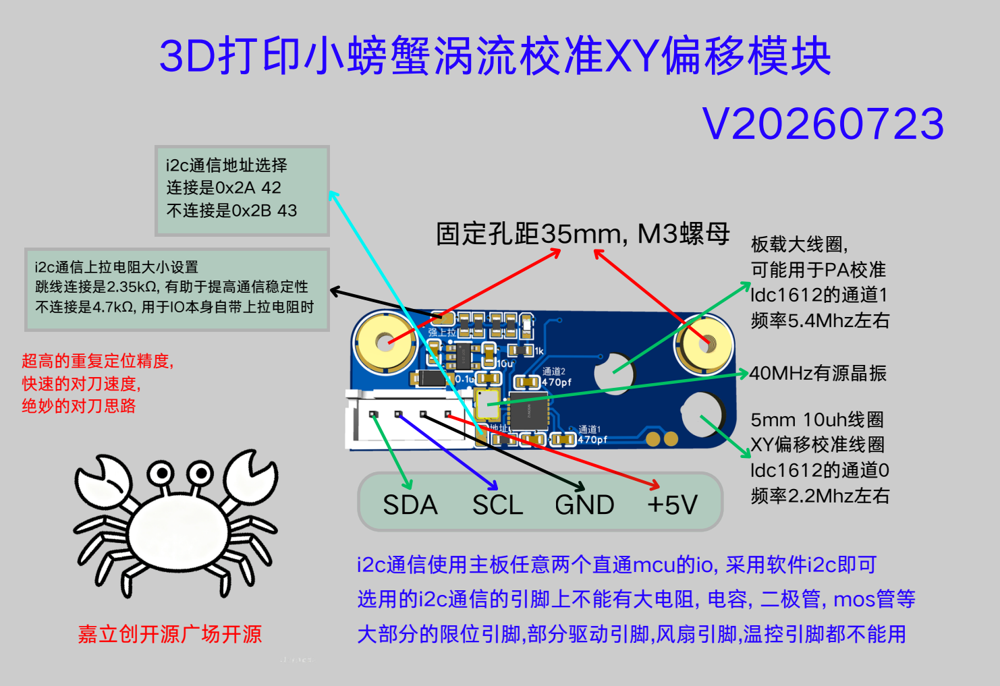

# tool_eddy_calibration

[English](README.en.md) | 中文

Klipper 多热头（工具切换）XY 喷嘴偏移校准插件。基于床装 LDC1612/LDC1614 涡流传感器板，
沿多方向直线扫描，检测频率响应极值位置，通过几何方法（配对平均 / 最小二乘）
重建各工具喷嘴的中心坐标，得到工具间 XY 偏移。



- 非接触测量，不怕脏喷嘴
- 多通道线圈支持（LDC1612 / LDC1614，随仓库附带 `ldc1612_2.py` 驱动，
  可运行时切换通道 0-3），每个通道独立配置线圈位置与扫描参数
- `TOOL_EDDY_FIND_COIL` 大范围蛇形光栅自动找线圈中心，无需手动量坐标；
  结果经 G-code `SAVE_VARIABLE` 持久化，重找时自动收缩搜索区域
- 自动检测信号形态（峰值形 / 谷底形）；峰值搜索以扫描中段为基准，
  抑制两侧杂散响应
- 高斯加权抛物线拟合实现亚采样精度的峰值定位
- 可选正反方向配对扫描，消除运动滞后误差
- 校准结果附带可信度判定（`trusted` / `fitR2` / `deviation` / `edgeScans`）：
  拟合 R² 须落在 `[trust_min_r2, trust_max_r2)` 区间、结果不偏离初始扫描
  中心、峰值不贴扫描线边缘，任一不满足即标记不可信
- 扫描线与搜索区域自动钳制到运动学行程范围（整线平移不截断），
  粗中心贴区域边缘时不会越程报错
- Z 偏移由外部 tap 探测（如 `probe_eddy_current` 的 `METHOD=TAP`）通过
  `SET_TOOL_Z` 写入

硬件参考：[嘉立创开源硬件 "小螃蟹" 双线圈板](https://oshwhub.com/cxg01/project_lbabffjk)
（原理图 / Gerber 见 [hardware/](hardware/) 目录）

版本：**V2.0.0**（`TOOL_EDDY_VERSION` 命令可查询）

## 仓库结构

```
tool_eddy_calibration/
├── klipper/                    # 插件本体
│   ├── tool_eddy_calibration.py    # 主机端插件 (装到 klippy/extras/)
│   ├── ldc1612_2.py                # 多通道 LDC1612/1614 驱动 (装到 klippy/extras/)
│   ├── firmware/sensor_ldc1612_2.c # MCU 侧采样模块 (装到 src/, 需重编译固件)
│   ├── install.sh                  # 安装脚本
│   └── uninstall.sh                # 卸载脚本
├── config/                     # 参考配置
│   ├── calibration-eddy.cfg    # 完整校准宏套件 (可直接 include)
│   ├── printer.cfg             # [tool_eddy_calibration] 配置示例
│   ├── printer_probe_eddy.cfg  # probe_eddy_current (tap) 配置示例
│   ├── myvariables.cfg         # save_variables 示例
│   └── moonraker.conf          # Moonraker 自动更新配置
├── hardware/                   # 硬件资料 (原理图 PDF / Gerber)
├── img/                        # 文档图片
├── data/                       # 数据资料 (扫描 CSV 样例, 峰值拟合可视化演示页)
└── LICENSE                     # GPLv3
```

## 安装

### 方式一：手动安装

```bash
cd ~
git clone https://github.com/chengxg/tool_eddy_calibration.git
cd tool_eddy_calibration
./klipper/install.sh
```

默认安装到 `~/klipper`，klipper 不在默认位置时指定目录：

```bash
./klipper/install.sh /path/to/klipper
```

安装脚本把主机端模块以**符号链接**方式放入 `klippy/extras/`（不支持符号链接时
回退为复制）；固件模块 `sensor_ldc1612_2.c` 放入 `src/` 并幂等修补
`src/Makefile`（`--host-only` 跳过固件部分）。之前手动复制过的旧文件会自动
备份为 `*.bak`。

### 方式二：Moonraker 托管安装（推荐）

先用方式一安装，再把 [config/moonraker.conf](config/moonraker.conf) 的内容追加到
打印机上的 `moonraker.conf`，重启 moonraker：

```ini
[update_manager tool_eddy_calibration]
type: git_repo
origin: https://github.com/chengxg/tool_eddy_calibration.git
path: ~/tool_eddy_calibration
install_script: klipper/install.sh
managed_services: klipper
primary_branch: main
```

之后在 Mainsail / Fluidd 的更新页面即可看到本插件，**检查更新、一键升级**，
更新后 Moonraker 自动运行安装脚本并重启 klipper。

> 注意：`primary_branch` 需与仓库默认分支名一致（`main` 或 `master`）。

## 固件支持（多通道必需）

单通道校准（`CHANNEL=0`）不依赖任何固件改动，任何 Klipper / Kalico 都能直接用。
要使用**多通道线圈切换**（`CHANNEL=1..3`），固件里必须有 MCU 侧采样模块
`sensor_ldc1612_2.c`（多通道变体，符号带 `_2` 后缀，与原版 `sensor_ldc1612.c` 并存）：

| 固件文件 | 来源 |
|---|---|
| `src/sensor_ldc1612.c`、`src/sensor_bulk.c`、`src/trigger_analog.c/.h`、`src/sos_filter.c/.h` | 固件自带（需较新的 Klipper / Kalico） |
| `src/sensor_ldc1612_2.c` | 本插件仓库 `klipper/firmware/` 目录自带 |

`install.sh` 会自动把 `sensor_ldc1612_2.c` 放入 `src/`，并幂等修补
`src/Makefile` 添加编译条目。目标固件缺少上述自带模块（版本过旧）时，
安装脚本会直接报错退出——本插件不支持旧版固件，请先升级 Klipper / Kalico
再安装。只想装主机端不碰固件时用 `./klipper/install.sh --host-only`。

安装后需要**重新编译并烧录固件**：

```bash
cd ~/klipper
make menuconfig    # 确认启用 I2C (LDC1612 支持默认自动启用), 保存退出
make
make flash         # 按你的主板烧录方式
```

烧录并重启后，用 `TEST_LDC1612` 验证传感器读数，`TOOL_EDDY_VERSION` 确认
插件版本与驱动（应显示 `version: 2.0.0`、`driver: ldc1612_2`）。

> 注意：Moonraker 更新本插件后，若固件源码有变化，需手动重新编译烧录固件
> （Moonraker 只会重启 klipper，不会重刷固件）。

## 配置

在 `printer.cfg` 中添加（节名可自定义后缀，多线圈可建多个节）：

```ini
[tool_eddy_calibration my_coil]
sensor_type: ldc1612
# 传感器 I2C 与驱动选项（写在本节内，与 [ldc1612 ...] 相同）
#i2c_mcu: rpi
#i2c_bus: i2c1
#i2c_address: 42          # 默认 0x2a
#frequency: 12000000      # 外部 CLKIN 频率, 按实际硬件填写
#data_rate: 400           # 采样频率 (Hz), 上限约 5000 (受稳定时间约束),
                          # 下限随 frequency 而定 (40MHz 时约 39)
#reg_drive_current: 25

# 线圈平面 Z（机器坐标）
coil_z: 0.5
# 找线圈的默认区域；TOOL_EDDY_FIND_COIL 的 REGION= 可临时覆盖
find_coil_region: 90,90,110,110
# 线圈内径 (mm), 影响峰值拟合窗口大小
#coil_inner_diameter: 2.0

# 扫描参数（相对线圈表面, scan_height 为负则低于线圈面）
#scan_height: 0.5
#scan_speed: 5.0
#scan_length: 10.0

# 通道 1-3 的独立覆盖（未填则沿用通道 0 的值; 需要 ldc1612_2.py 与多线圈硬件）
#coil_z1: 0.5
#find_coil_region1: 95,90,115,110
#coil_inner_diameter1: 2.0
#scan_height1: 0.5
#scan_speed1: 5.0
#scan_length1: 10.0
# （coil_z2 / find_coil_region2 ... 同理, 最多 4 通道）
#
# 单线圈模块: 只保留实际接线通道的那组参数即可（通道 0 = 无后缀,
# 通道 N = 数字后缀）, 其余组整段删除 -- 用不到的通道不会做配置校验。
# 线圈 XY 中心不属于静态配置, 由 TOOL_EDDY_FIND_COIL 搜出后经 G-code 保存。

# 通用运动参数
#travel_speed_xy: 100     # XY 移动速度 (mm/s)
#travel_speed_z: 10       # Z 移动速度 (mm/s)
#scan_safe_z: 2.0         # 扫描前后抬升的安全高度 (mm)

# 校准结果可信度判定 (任一条件不满足则 trusted=False)
#trust_max_deviation: 1.0 # 结果偏离初始扫描中心的最大允许偏差 (mm)
#trust_min_r2: 0.996      # 各方向抛物线拟合 R² 须 >= 此值
#trust_max_r2: 1.0        # 拟合 R² 须 < 此值 (好到近乎无噪声视为异常)
#trust_edge_margin: 1.0   # 峰值距扫描线端点小于此值 (mm) 视为贴边缘, 不可信

# 调试
#save_data: False         # 保存扫描原始数据到配置同级 tool_eddy_calibration/ 目录
```

### 配置项说明

| 选项 | 默认值 | 范围 | 说明 |
|---|---|---|---|
| `coil_z` | 必填 | - | 线圈表面的机器 Z；执行找线圈或校准前必须配置 |
| `find_coil_region` | 必填 | - | 默认找线圈区域，格式 `xmin,ymin,xmax,ymax`；通道 N 可用 `find_coil_regionN` 覆盖，命令 `REGION=` 优先 |
| `coil_inner_diameter` | 2.0 | 1.5~30 | 线圈内径，决定峰值拟合窗口 |
| `scan_height` | 0.5 | -20~50 | 扫描平面相对线圈表面的高度 (mm) |
| `scan_speed` | 5.0 | 0.5~20 | 扫描移动速度 (mm/s) |
| `scan_length` | 10.0 | 2~20 | 单次扫描长度 (mm) |
| `travel_speed_xy` | 100 | 5~300 | XY 空行速度 (mm/s) |
| `travel_speed_z` | 10 | 1~50 | Z 移动速度 (mm/s) |
| `scan_safe_z` | 2.0 | 0.5~10 | 安全抬升高度 (mm) |
| `trust_max_deviation` | 1.0 | 0.05~10 | 结果偏离初始扫描中心的最大允许偏差 (mm)，超出判不可信 |
| `trust_min_r2` | 0.996 | 0~1 | 各方向抛物线拟合 R² 的最低要求，低于判不可信 |
| `trust_max_r2` | 1.0 | 0~1 | 拟合 R² 的上界（不含），达到此值视为异常（近乎无噪声，通常是数据异常） |
| `trust_edge_margin` | 1.0 | 0.1~10 | 峰值距扫描线端点小于此值 (mm) 视为贴边缘（峰值可能被截断，拟合度再高也不可用） |
| `save_data` | False | - | 保存扫描原始数据到配置同级的 `tool_eddy_calibration/` 目录 |

## 使用流程

完整的宏套件在 [config/calibration-eddy.cfg](config/calibration-eddy.cfg)，
include 后按下面顺序使用：

### 1. 首次找线圈中心

```
FIND_ALL_TOOL_EDDY_COIL_CENTERS
```

对每个工具：装上工具头 → 在配置的 `find_coil_region` 区域内蛇形光栅搜索 →
正交精扫定位中心 → `SAVE_VARIABLE` 保存为 `t{tool}_coil_x_{channel}` /
`t{tool}_coil_y_{channel}`。重跑时自动以已保存中心收缩搜索区域
（±`refine_radius`，默认 3mm），扫描行数按平方减少；`FORCE=1` 强制全区域。

单工具重找：`FIND_TOOL_EDDY_COIL_CENTER TOOL=1`（可选 `CHANNEL=` / `RADIUS=` / `FORCE=1`）

### 2. 校准工具偏移

```
CALIBRATE_ALL_TOOLS_EDDY      # 批量 (分组预热, 每组最多3个热端)
CALIBRATE_TOOL_EDDY TOOL=0    # 单个
```

每个工具自动执行：tap 探测 Z → `SET_TOOL_Z` → 以保存的线圈中心为基准
多方向扫描 → 结果与偏移存入 save_variables（`t{n}_offset_x/y/z`）。
校准结果带可信度，`trusted` 为 False 时会给出具体原因
（偏离过大 / 拟合度不达标 / 峰值贴边缘）。

### 3. 查询结果

```
GET_TOOL_CENTER TOOL=0
```

## Gcode 命令

| 命令 | 参数 | 说明 |
|---|---|---|
| `TOOL_EDDY_CALIBRATE` | `TOOL=`（必填）, `CENTER_XY=x,y`（必填）, `CHANNEL=0..3`, `SCAN_HEIGHT_OFFSET=`, `REPEATS=1..10`, `PAIR_CANCEL=0/1`, `DIR=45,135` | 以本次 `CENTER_XY` 为基准校准指定工具的中心坐标 |
| `TOOL_EDDY_FIND_COIL` | `[REGION=xmin,ymin,xmax,ymax]`, `[GRID=1]`, `[RASTER_SPEED=20]`, `[CHANNEL=0]` | 大范围自动找线圈中心：命令区域优先于 `find_coil_region`，输出 `CENTER_XY` 供 G-code 保存 |
| `GET_TOOL_CENTER` | `TOOL=` | 查询该工具上次校准结果 |
| `SET_TOOL_Z` | `TOOL=`, `Z=` | 由外部来源（如 tap 探测）写入该工具的 Z 坐标 |
| `CLEAR_TOOL_CENTER` | `[TOOL=]` | 清除某工具或全部工具的校准数据 |
| `TEST_LDC1612` | `[CHANNEL=]`, `[DURATION=0.1]` | 传感器连通性/稳定性测试，输出频率统计与质量评估 |
| `SET_TOOL_EDDY_CHANNEL` | `CHANNEL=0..3` | 切换活动线圈通道（各命令也支持直接带 `CHANNEL=`） |
| `SET_LDC1612_DATA_RATE` | `CHIP=`（节名）, `RATE=` | 运行时修改采样频率（Hz），RCOUNT 约束校验同配置项 |
| `TOOL_EDDY_VERSION` | 无 | 显示插件版本、驱动类型与当前通道，用于确认更新是否生效 |

### 状态查询（宏 / 前端）

`get_status` 返回每个工具的 `x` / `y` / `z`，XY 校准过的条目还带 `fitR2`
（各方向拟合度最小值）/ `deviation`（与初始扫描中心的偏差, mm）/
`edgeScans`（贴边缘扫描次数）/ `trusted`（可信度，`False` 时结果应丢弃），
以及 `version` / `channel` / `has_ldc1612_2`：

```

...结果不可信, 需重校...
```

## 更新

- **Moonraker 托管**：前端更新页面直接升级，无需手动操作。
- **手动更新**：

```bash
cd ~/tool_eddy_calibration
git pull
```

符号链接安装方式下 `git pull` 即时生效（复制安装方式需重跑
`./klipper/install.sh`），之后重启 klipper 并用 `TOOL_EDDY_VERSION` 确认版本号。

## 卸载

```bash
cd ~/tool_eddy_calibration
./klipper/uninstall.sh
```

并从 `printer.cfg` 删除 `[tool_eddy_calibration ...]` 节、从 `moonraker.conf`
删除 `[update_manager tool_eddy_calibration]` 节，最后重启 klipper。

## 许可证

GNU GPLv3。`ldc1612_2.py` 基于 Klipper 的 `ldc1612.py`（Kevin O'Connor）修改。
